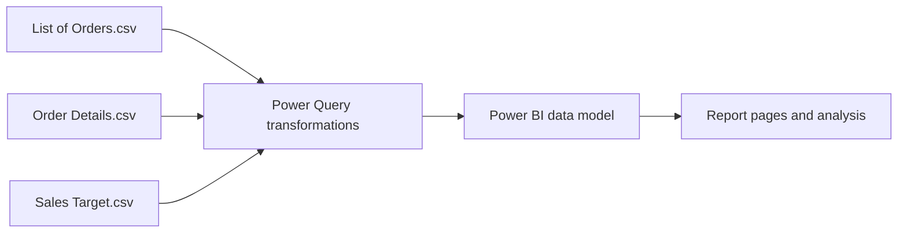
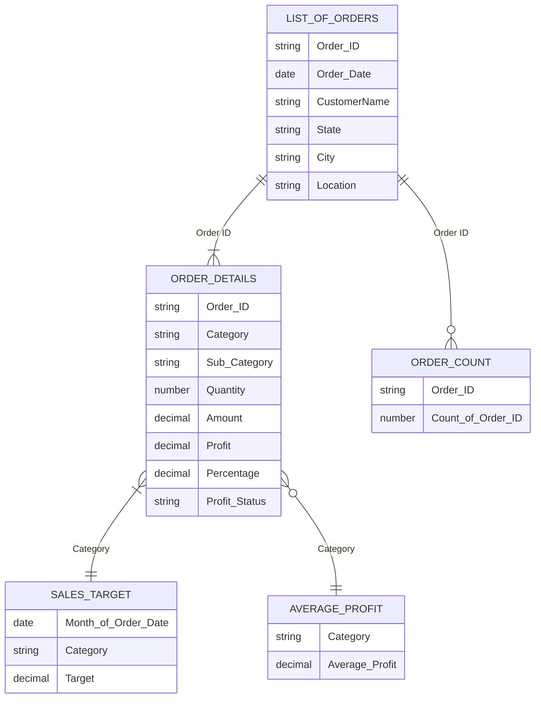
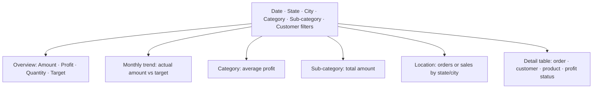

# 📊 Power BI Data Import, Transformation & Modeling

A Power BI project that prepares order, order-detail, and sales-target data for reliable exploration and sales performance reporting.

## 🎯 Project Overview

### Business problem

Order, product, customer, location, and target data are stored in separate CSV tables. They need to be cleaned and related before users can compare sales, profit, and target performance consistently.

### Objective

Import and transform the three source tables with Power Query, create useful calculated and grouped data, and establish a Power BI model that can support sales analysis.

### Target audience

This project is useful for Power BI learners, data analysts, and sales teams who need a documented example of a data preparation and modeling workflow.

> **Scope:** The supplied PDF documents Power Query transformations and data modeling. It does not include a finished dashboard with report charts. Dashboard filters and visuals below are clearly marked as recommended extensions.

## 🗃️ Data Sources & Architecture

### Source files and tables

| CSV file | Power BI table | Purpose | Fields shown in the PDF |
|---|---|---|---|
| `List of Orders.csv` | `List of Orders` | Order, customer, and location information | Order ID, Order Date, CustomerName, State, City |
| `Order Details.csv` | `Order Details` | Product and transaction details | Order ID, Amount, Profit, Quantity, Category, Sub-Category, Custom, Percentage |
| `Sales Target.csv` | `Sales Target` | Category targets by month | Month of Order Date, Category, Target |

### Architecture overview



The PDF shows the three CSVs loaded in Power Query Editor and then represented as tables in Power BI Model view. Data volume in the documented exercise includes a 500-row order sample. The PDF does not state the storage mode or refresh configuration.

## ⚙️ Data Transformation (ETL)

**Tool used:** Power Query Editor in Power BI Desktop.

The following steps follow the ten sections in the PDF. M examples are provided where useful; replace `PreviousStep` and query names with the actual names in Power Query.

### Step 1: Import the source files

Import `List of Orders.csv`, `Order Details.csv`, and `Sales Target.csv` into Power BI. Choose **Transform Data** to inspect and edit the tables in Power Query Editor.

### Step 2: Limit rows and assign data types

- Keep the first **500 rows** in `List of Orders`.
- Set `Order Date` to **Date**.
- Set `Amount` in `Order Details` to **Fixed decimal number**.
- Set `Target` in `Sales Target` to **Fixed decimal number**.

```powerquery
// Keep the first 500 order rows
Table.FirstN(PreviousStep, 500)
```

The 500-row cap is part of the documented exercise. Decide whether to retain or remove it for a complete production dataset.

### Step 3: Format text

Capitalize each word in `CustomerName` to standardize customer-name display.

```powerquery
Table.TransformColumns(
    PreviousStep,
    {{"CustomerName", Text.Proper, type text}}
)
```

### Step 4: Create columns

**Create `Location` in `List of Orders`** by merging City and State with a comma separator:

```powerquery
Table.AddColumn(
    PreviousStep,
    "Location",
    each [City] & ", " & [State],
    type text
)
```

Null-safe option:

```powerquery
Table.AddColumn(
    PreviousStep,
    "Location",
    each Text.Combine(List.RemoveNulls({[City], [State]}), ", "),
    type text
)
```

**Create `Percentage` in `Order Details`** using the PDF formula `Profit / Amount`:

```powerquery
Table.AddColumn(
    PreviousStep,
    "Percentage",
    each if [Amount] = null or [Amount] = 0
         then null
         else [Profit] / [Amount],
    Percentage.Type
)
```

The null/zero check prevents division errors. Format the resulting field as a percentage in the model if desired.

### Step 5: Add a conditional column

Create `Profit Status` from `Profit`:

| Condition | Result |
|---|---|
| Profit < 0 | `Loss` |
| Profit = 0 | `Break-Even` |
| Profit > 0 | `Profit` |

```powerquery
Table.AddColumn(
    PreviousStep,
    "Profit Status",
    each if [Profit] < 0 then "Loss"
         else if [Profit] = 0 then "Break-Even"
         else "Profit",
    type text
)
```

### Step 6: Merge orders with details

Merge `List of Orders` with `Order Details` using `Order ID`. The PDF specifies a **Left Outer** join and names the merged output `Orders Data`. The merge dialog reports that all 500 sample order rows matched. Expand the nested detail table to include the required detail columns.

```powerquery
Table.NestedJoin(
    Orders,
    {"Order ID"},
    OrderDetails,
    {"Order ID"},
    "Order Details",
    JoinKind.LeftOuter
)
```

### Step 7: Handle missing and duplicate data

The PDF's data-quality review reports:

| Table | Finding | Action described in the PDF |
|---|---|---|
| `List of Orders` | 60 completely blank rows after row 500 in the CSV | Keep the first 500 rows; the blank rows contain no order information |
| `Order Details` | No missing values found | No missing-value action needed |
| `Sales Target` | No missing values found | No missing-value action needed |

Remove fully identical duplicate rows from each table. Do not deduplicate `Order Details` using `Order ID` alone: repeated order IDs are expected when an order contains multiple product lines.

```powerquery
// Removes fully identical rows across all columns
Table.Distinct(PreviousStep)
```

### Step 8: Sort and filter

- Sort `List of Orders` by `Order Date` in descending order.
- Filter `State` to `Tamil Nadu` for the example analysis.
- The PDF shows **8 orders** in the filtered result, all for Chennai.

```powerquery
Table.Sort(PreviousStep, {{"Order Date", Order.Descending}})

Table.SelectRows(PreviousStep, each [State] = "Tamil Nadu")
```

This is a Power Query filter shown in the walkthrough, not a report-page slicer.

### Step 9: Group and aggregate

The PDF duplicates tables and creates these Group By summaries:

| Summary | Group by | Operation |
|---|---|---|
| Order count | `Order ID` | Count Rows |
| Average profit | `Category` | Average of `Profit` |
| Total amount | `Sub-Category` | Sum of `Amount` |
| Total target | `Month of Order Date` | Sum of `Target` |

Example: average profit by category.

```powerquery
Table.Group(
    PreviousStep,
    {"Category"},
    {{"Average Profit", each List.Average([Profit]), type nullable number}}
)
```

The order-count example counts detail rows for each order ID. If an order has multiple product lines, this is not the same as counting distinct orders.

### Step 10: Create and check relationships

The PDF shows **Manage Relationships** with active relationships. It documents:

- `List of Orders[Order ID]` to `Order Details[Order ID]`: **one-to-many**, single cross-filter direction.
- `Order Details[Category]` to `Sales Target[Category]`.
- Additional category-based links to the `Average profit` summary and an Order ID link to the order-count summary in the model screenshots.



> Validate cardinality and filter direction in the actual `.pbix` model. Category alone may not be enough to compare actual sales to monthly targets because the target table is also at a month grain. A date/month dimension or validated key may be needed.

## 🧠 Data Model & DAX

### Model type

The PDF shows related transaction and summary tables in Model view. It does not identify the design as a formal star or snowflake schema.

Suggested DAX measures for report calculations are listed in the [Formulas](#-formulas) section. They are not shown as existing measures in the PDF. Target attainment is meaningful only when actual amounts and targets use compatible category and month filters; validate the relationship before publishing a comparison.

## 🔎 Filters

### Filters demonstrated in the PDF

| Filter | Applied to | Setting/result |
|---|---|---|
| Keep top rows | `List of Orders` | Keep first 500 rows |
| Sort | `List of Orders[Order Date]` | Descending order, newest first |
| State | `List of Orders[State]` | `Tamil Nadu`; the shown result contains 8 Chennai orders |

Power Query M equivalents:

```powerquery
// Keep the first 500 rows
Table.FirstN(PreviousStep, 500)

// Sort newest order date first
Table.Sort(PreviousStep, {{"Order Date", Order.Descending}})

// Keep only Tamil Nadu orders
Table.SelectRows(PreviousStep, each [State] = "Tamil Nadu")
```

### Suggested report filters

These are proposed slicers for an interactive report, not existing PDF features.

| Slicer | Field | Suggested control |
|---|---|---|
| Date | `List of Orders[Order Date]` | Between/date range |
| State | `List of Orders[State]` | Searchable dropdown |
| City | `List of Orders[City]` | Searchable dropdown |
| Category | `Order Details[Category]` | Dropdown or tile slicer |
| Sub-category | `Order Details[Sub-Category]` | Searchable dropdown |
| Customer | `List of Orders[CustomerName]` | Searchable dropdown |

Consider synchronizing slicers across pages, making City respond to State, displaying active selections, and adding a **Clear filters** button.

## 🧮 Formulas

The first three calculations below translate formulas and rules documented in the PDF. The DAX measures are optional report additions.

### Profit percentage

The PDF's custom column formula is `Profit / Amount`. This guarded Power Query version avoids division by zero or null:

```powerquery
if [Amount] = null or [Amount] = 0
then null
else [Profit] / [Amount]
```

### Profit status

```powerquery
if [Profit] < 0 then "Loss"
else if [Profit] = 0 then "Break-Even"
else "Profit"
```

### Location

The PDF combines City and State with a comma separator:

```powerquery
[City] & ", " & [State]
```

### Suggested DAX measures

These are suggested report calculations, not measures shown in the PDF. Confirm table and column names in the Power BI model.

```DAX
Total Amount = SUM('Order Details'[Amount])
Total Profit = SUM('Order Details'[Profit])
Total Quantity = SUM('Order Details'[Quantity])
Distinct Orders = DISTINCTCOUNT('List of Orders'[Order ID])
Profit Margin % = DIVIDE([Total Profit], [Total Amount])
Total Target = SUM('Sales Target'[Target])
Target Attainment % = DIVIDE([Total Amount], [Total Target])
Target Variance = [Total Amount] - [Total Target]
```

Use target measures only after validating the relationship between order dates and target months.

## 🖥️ Dashboard Features

The PDF does not include report pages or finished dashboard visuals. The following visuals and highlights are proposed extensions based on the available fields and grouped summaries. Use the slicers listed in the [Filters](#-filters) section; synchronize them across pages, show active selections, and add a **Clear filters** button where useful.

### Suggested report pages and visuals

| Page | Suggested visuals | Analysis purpose |
|---|---|---|
| Sales Overview | KPI cards for Amount, Profit, Quantity, Target; monthly trend | Summarize performance and target progress |
| Product Performance | Bar charts for Average Profit by Category and Total Amount by Sub-Category | Identify product groups driving sales or profit |
| Order & Location Detail | State/City chart and order detail table | Explore customer, order, and location patterns |



### Conditional formatting for highlights

| Highlight | Field or measure | Suggested colors/format |
|---|---|---|
| Loss-making detail | `Profit Status` or `Profit` | Red for Loss/negative, neutral for Break-Even, green for Profit/positive |
| Low margin | `Profit Margin %` | Red below 0%, amber for low positive margin, green for stronger margin |
| Target progress | `Target Attainment %` or `Target Variance` | Red below 100% attainment, green at/above 100% |
| Sales contribution | `Total Amount` by category/sub-category | Data bars or a ranked color scale |

These highlights should respond to slicers. Verify that measures are evaluated at the intended order, product, category, and month grain.

## 💡 Key Insights

The PDF provides transformation examples and summary tables, but no completed chart dashboard or broad business conclusions. The directly observable takeaways are:

- The sample order table is limited to 500 rows; the PDF notes 60 blank rows after that range in the CSV.
- The example Tamil Nadu state filter returns 8 orders, all shown for Chennai.
- The workflow creates average-profit summaries for three categories, total-amount summaries for 17 sub-categories, and monthly target summaries for 12 months.
- Profit is classified into Loss, Break-Even, and Profit, enabling a future report to highlight negative and positive detail rows.

### Recommended next analysis

Use the recommended date, location, category, and sub-category filters to find where sales or profit are strongest and where results are below target. Validate the date/category model before interpreting target attainment. Do not treat the suggested dashboard visuals as findings already demonstrated by the PDF.

## 🚀 How to Use

1. Install Power BI Desktop.
2. Place `List of Orders.csv`, `Order Details.csv`, and `Sales Target.csv` in an accessible folder.
3. Import each file with **Get Data → Text/CSV**.
4. Select **Transform Data** and apply the ten ETL steps documented above.
5. Verify column names, types, row limit, duplicate handling, and formula behavior against the source data.
6. Select **Close & Apply**, then build and validate the relationships in Model view.
7. If creating a report, add the suggested measures, slicers, visuals, and conditional formatting.
8. Reconcile totals against the source tables before sharing the report.

The supplied PDF does not include the source CSVs or a `.pbix` file. Those files are required to reproduce the workflow and validate the model.

## ✅ Conclusion

This project documents a full Power BI preparation workflow: importing three CSV tables, limiting rows and setting types, standardizing customer names, creating Location and Percentage columns, classifying Profit Status, merging orders with details, checking missing and duplicate rows, sorting and filtering, grouping summaries, and defining model relationships.

The result is a documented data-model foundation rather than a finished dashboard. Before using it for decisions, validate the 500-row limit, formulas, aggregation definitions, relationship keys, and month-level target alignment. The proposed slicers, visuals, and conditional highlights provide a practical next step for turning the model into an interactive sales analysis report.
